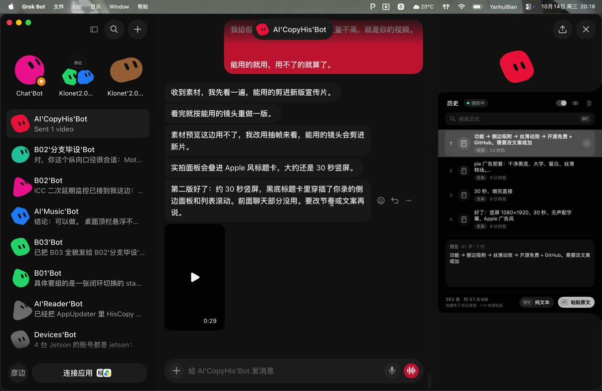
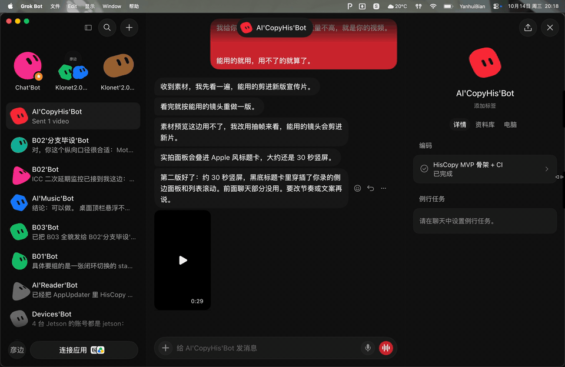
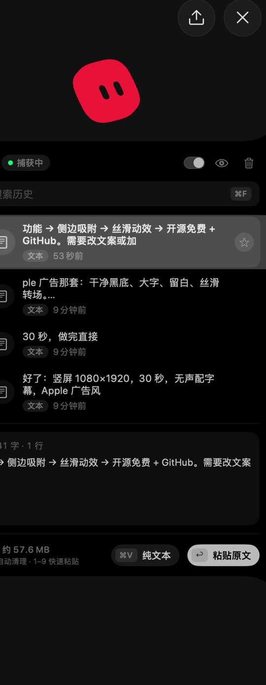
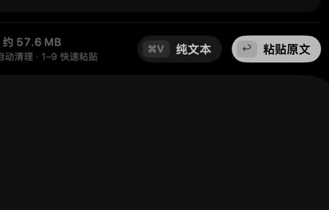

# HisCopy

原生 macOS 菜单栏剪切板历史 — 侧边吸附、⇧⌘V 一键呼出、丝滑动画。开源免费。

[](https://github.com/BianYanhui/HisCopy/releases)
[](LICENSE)
[](https://github.com/BianYanhui/HisCopy/releases)

**下载：** [最新 Release（HisCopy.zip）](https://github.com/BianYanhui/HisCopy/releases/latest) · 当前 **v0.8.8**

<p align="center">
  
</p>

| ⇧⌘V 热键呼出 | 侧边呼出 |
|:---:|:---:|
|  |  |

> 吸附模式下，鼠标移近边缘也会弹簧滑出面板（与热键相同的开合动画）。上方右侧 GIF 取自二次打开/滑出片段。

<p align="center">
  
  &nbsp;
  
</p>

竖屏宣传片（小红书风）：[`docs/media/promo-xhs.mp4`](docs/media/promo-xhs.mp4)

---

## 功能

- **侧边吸附**：面板收为左 / 右 / 顶部边缘细条；⇧⌘V 从边缘弹出，鼠标移近亦可展开；拖动标题换边 / 换屏，位置按显示器记住
- **全局热键**：默认 **⇧⌘V** 呼出 / 隐藏；可在设置中修改
- **双模式粘贴**：选中后 **⌘V** 粘贴纯文本，**回车** 粘贴有格式原文；前 9 条可按数字键快速粘贴
- **预览**：图片 / 全文 / 文件列表；眼睛按钮可关
- **搜索与收藏**：⌘F 搜索；星标收藏免于自动清理
- **保留策略**：可配置容量上限与保留时长
- **开机启动**：系统登录项（`SMAppService`），设置页显示真实状态
- **在线更新**：检查 GitHub Releases，旁路替换 `.app`
- **稳定签名**（v0.8.8）：Release 使用持久自签证书 `HisCopy Self-Signed`，辅助功能跨更新一般可保留（见 [docs/CODE_SIGNING.md](docs/CODE_SIGNING.md)）
- **零第三方依赖**：纯 Swift / AppKit；面板外观灵感来自 [Pulse](https://github.com/qunqin24/Pulse)（Apache-2.0，见 [THIRD_PARTY_NOTICES.md](THIRD_PARTY_NOTICES.md) / [NOTICE](NOTICE)）

## 权限说明

| 能力 | 是否需要辅助功能 | 说明 |
|------|------------------|------|
| 全局热键呼出面板 | 通常不需要 | Carbon / CGEvent 热键路径 |
| 菜单栏常规菜单 | 不需要 | 标准 `NSStatusItem` |
| ⌘V / 回车一键粘贴 | **需要** | `AXIsProcessTrusted` + `CGEvent` 模拟 ⌘V |

首次粘贴失败时会引导打开 **系统设置 → 隐私与安全性 → 辅助功能**。未授权前仍会写入剪贴板，可手动 ⌘V。

## 限制

- **未公证**；Release 为稳定自签（`HisCopy Self-Signed`，v0.8.8+）。缺失 CI 密钥时回退 ad-hoc
- 首次换到 Self-Signed 后需**一次性**重新勾选辅助功能；之后同签名更新一般不必再勾

### 未公证打开方式

- 右键 App →「打开」
- 或终端：`xattr -cr /path/to/HisCopy.app`

## 本地开发

用 Xcode 打开 `HisCopy.xcodeproj`，选择 scheme **HisCopy** 运行。

要求：macOS 13.0+，Xcode 16+。零第三方依赖。

## 发版

合并到 `main` 后打 tag 触发 CI 构建并创建 Release：

```bash
git tag v0.8.8
git push origin v0.8.8
```

## 近期版本

完整变更见 [Releases](https://github.com/BianYanhui/HisCopy/releases)。

| 版本 | 摘要 |
|------|------|
| **v0.8.8** | 稳定自签代码签名，辅助功能跨更新保留 |
| **v0.8.7** | 热键以 CGEvent 为主路径，清理调试残留 |
| **v0.8.6** | 吸附面板永不 `makeKey` |
| **v0.8.5–0.8.2** | Carbon / 热键可靠性修复 |
| **v0.8.1** | 开机启动（SMAppService）、去重、预览、吸附拖动等细节 |
| **v0.8.0** | 屏幕边缘吸附 + Pulse 视觉风格 |
| **v0.7.x** | 非激活面板、粘贴焦点恢复、UI 成品打磨 |
| **v0.6.x** | 保留策略、收藏、搜索焦点 |

## License

MIT

## 代码签名与辅助功能

GitHub Actions Release 使用稳定自签身份 **`HisCopy Self-Signed`**（不是每次不同的 ad-hoc）。这样系统「辅助功能」可以在版本更新后继续认同一份应用。

- 细节与轮换证书：[docs/CODE_SIGNING.md](docs/CODE_SIGNING.md)
- **首次**换到本签名后：删除辅助功能列表里所有旧 HisCopy，再添加当前 `.app`，重启应用并「重新检查权限」
- 之后用本仓库 CI 打出的更新包，一般不必再勾选
